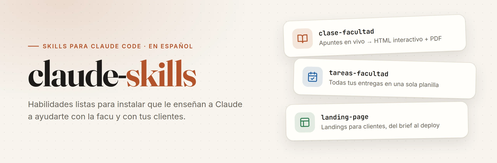
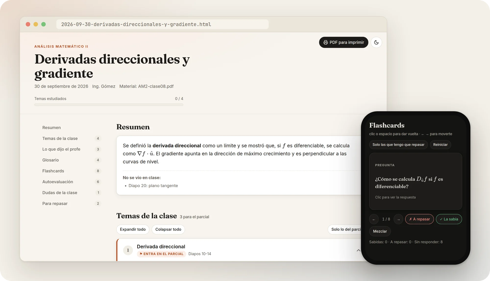
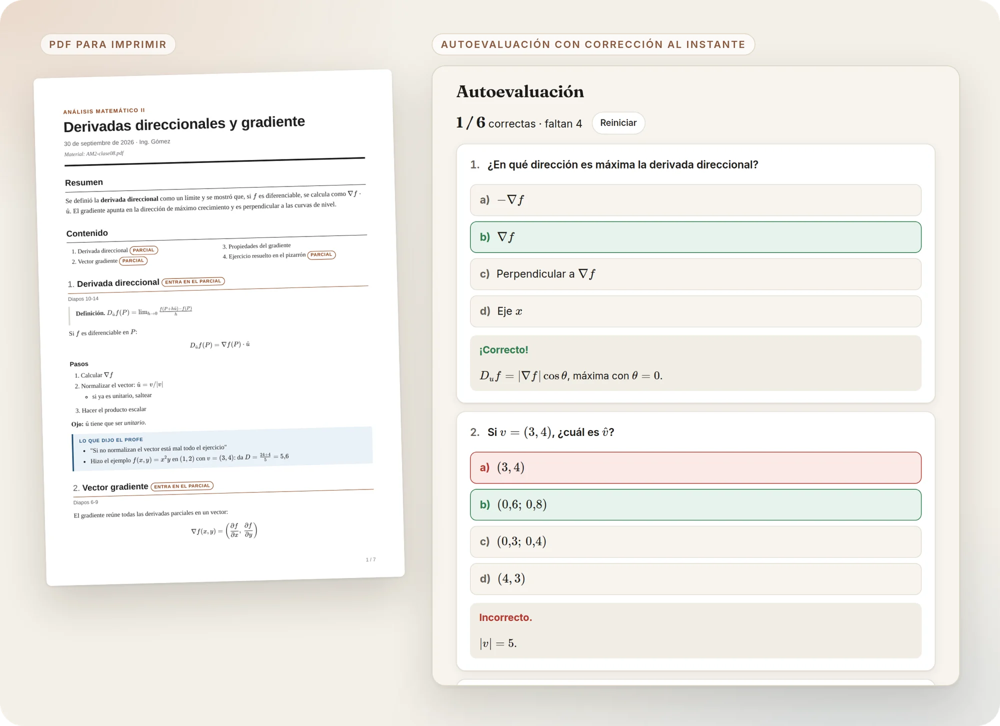
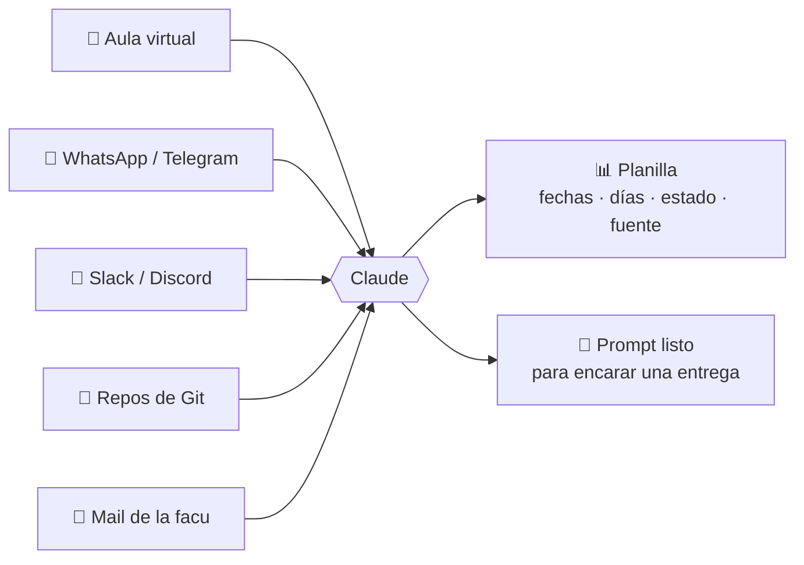
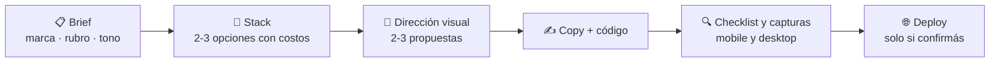

<picture>
  <source media="(prefers-color-scheme: dark)" srcset=".github/assets/banner-dark.webp">
  
</picture>

<p align="center">
  <a href="https://claude.com/claude-code"></a>
  
  
  <a href="LICENSE"></a>
  <a href="https://github.com/Valentino-git2305/claude-skills/commits/main"></a>
</p>

<p align="center">
  <a href="#-instalación-en-30-segundos">Instalación</a> ·
  <a href="#-clase-facultad">clase-facultad</a> ·
  <a href="#-tareas-facultad">tareas-facultad</a> ·
  <a href="#-landing-page">landing-page</a> ·
  <a href="#-preguntas-frecuentes">FAQ</a>
</p>

---

### ¿Qué es una skill?

Una **skill** es un paquete de instrucciones (y a veces scripts) que le enseña a Claude a hacer una tarea concreta siempre igual de bien. La instalás una vez y Claude la usa sola cuando le pedís algo relacionado: no hace falta explicarle todo de nuevo cada vez.

| | Skill | Qué hace | Para quién |
|:-:|---|---|---|
| 📚 | [**clase-facultad**](#-clase-facultad) | Toma apuntes en vivo mientras el profe explica y al final te arma un **HTML interactivo** y un **PDF** para estudiar | Estudiantes |
| 🗓️ | [**tareas-facultad**](#-tareas-facultad) | Junta las entregas de **todas las materias y todas las plataformas** en una sola planilla | Estudiantes |
| 🚀 | [**landing-page**](#-landing-page) | Arma landing pages para clientes: del brief al deploy, con stack recomendado y diseño propio | Freelancers |

## ⚡ Instalación en 30 segundos

Necesitás [Claude Code](https://claude.com/claude-code) y [Node.js](https://nodejs.org).

```bash
npx skills add https://github.com/Valentino-git2305/claude-skills --skill clase-facultad --agent claude-code -g
```

- Cambiá `clase-facultad` por `tareas-facultad` o `landing-page` para instalar otra, o por `'*'` para instalarlas todas.
- `-g` la deja disponible en todas tus carpetas. Sin `-g`, solo en la carpeta donde estás.
- Abrí una sesión nueva de Claude Code y listo.

Para actualizar cuando haya novedades: `npx skills update`

---

## 📚 clase-facultad

> *"Arranca la clase de Análisis II, hoy vemos gradiente"* — y le pasás el PDF de la clase.

Mientras el profe explica, le vas escribiendo lo que dice (aunque sea abreviado y con errores). Claude **guarda todo al instante** y te contesta en 2-4 líneas: aclara, conecta con las diapositivas y marca lo que entra en el parcial. Al decir *"terminó la clase"* genera tu material de estudio:





**Qué trae el material**

- 🧭 Resumen e índice de temas, con filtro *"solo lo del parcial"*
- 🗣️ **Lo que dijo el profe**, destacado aparte de la explicación
- 🃏 Flashcards con *"la sabía / a repasar"*
- ✅ Autoevaluación de opción múltiple que corrige y explica
- 📖 Glosario con buscador, dudas de la clase resueltas y checklist para repasar
- 🌙 Modo oscuro, fórmulas en LaTeX y progreso guardado
- 🖨️ PDF A4 con preguntas de repaso y las respuestas al final

<details>
<summary><b>Requisitos y detalles</b></summary>

- Python 3 (sin librerías extra).
- Chromium, Chrome, Edge o Brave para generar el PDF. Si no hay ninguno, genera una versión imprimible que guardás como PDF con Ctrl+P.
- Internet al abrir el material, para que se vean las fórmulas.
- No arranca hasta que le digas **materia y tema**. Todo queda en `~/Facultad/<Materia>/<fecha>-<tema>/`.
- Si se corta la sesión, retoma la clase desde el registro guardado.

</details>

---

## 🗓️ tareas-facultad

> *"Revisá la cátedra y actualizá mis tareas"*

Las materias no publican todas en el mismo lugar. Esta skill **barre todas las fuentes** y consolida lo pendiente en un Excel o Google Sheets.



- **Columna Fuente**: sabés de dónde salió cada dato y cuál puede estar desactualizado.
- **Cambios desde la última corrida**, lo primero que ves al abrirla.
- *"Dame un prompt para el TP de Redes"*: busca la consigna real, lee los adjuntos y te arma el prompt con todo el contexto.

<details>
<summary><b>Requisitos y detalles</b></summary>

- Python 3 con `openpyxl` (o el conector de Google Workspace para Sheets).
- Navegador con las sesiones ya iniciadas (aula virtual, WhatsApp Web, mail). **Nunca ingresa contraseñas.**
- La primera vez te pregunta qué materias cursás y dónde publica cada una; después lo recuerda.

</details>

---

## 🚀 landing-page

> *"Creá una landing para un cliente nuevo"* o `/landing-page`



- **No usa plantillas**: la dirección visual sale de la skill [`frontend-design`](https://github.com/anthropics/skills) (se instala sola si no la tenés), aplicada al rubro y tono del cliente.
- **Recomienda el stack** según el caso: HTML + Tailwind, Astro, Next.js, WordPress, no-code o tienda online, con pros, contras y costos.
- Guías incluidas para **11 rubros** y **5 tonos** de copy en español.
- Entrega con **checklist**: favicon, SEO y Open Graph, formulario, WhatsApp, analytics y links.
- Cuando un cliente aprueba una landing, decile *"esta quedó aprobada"* y la usa de referencia para los próximos.

<details>
<summary><b>Requisitos y detalles</b></summary>

- Node.js y Python 3. Playwright para las capturas (la primera vez descarga su navegador).
- Para el deploy, la cuenta y CLI de la plataforma elegida; si falta algo, te dice qué hacer.
- ⚠️ `aprobadas.md` vive dentro de la skill: hacé una copia antes de `npx skills update`, porque se reemplaza.

</details>

---

## ❓ Preguntas frecuentes

<details>
<summary><b>¿Necesito saber programar?</b></summary>

No. Instalás con un comando y después le hablás a Claude normalmente. `landing-page` sí genera código, pero lo arma Claude.
</details>

<details>
<summary><b>¿Funcionan en claude.ai o solo en Claude Code?</b></summary>

Están pensadas para Claude Code, porque usan archivos, scripts y el navegador.
</details>

<details>
<summary><b>¿Mis datos se suben a algún lado?</b></summary>

No. Los apuntes, planillas y landings se guardan en tu computadora. Las skills no mandan nada a este repo.
</details>

<details>
<summary><b>Quiero proponer una skill o encontré un error</b></summary>

¡Buenísimo! Abrí un [issue](https://github.com/Valentino-git2305/claude-skills/issues). Para sumar una skill, creá `skills/<nombre>/SKILL.md` y mandá un pull request.
</details>

---

<p align="center">
  Hecho con ☕ y <a href="https://claude.com/claude-code">Claude Code</a> · <a href="LICENSE">MIT</a><br>
  Si te sirvió, dejale una ⭐ al repo así le llega a más gente.
</p>
